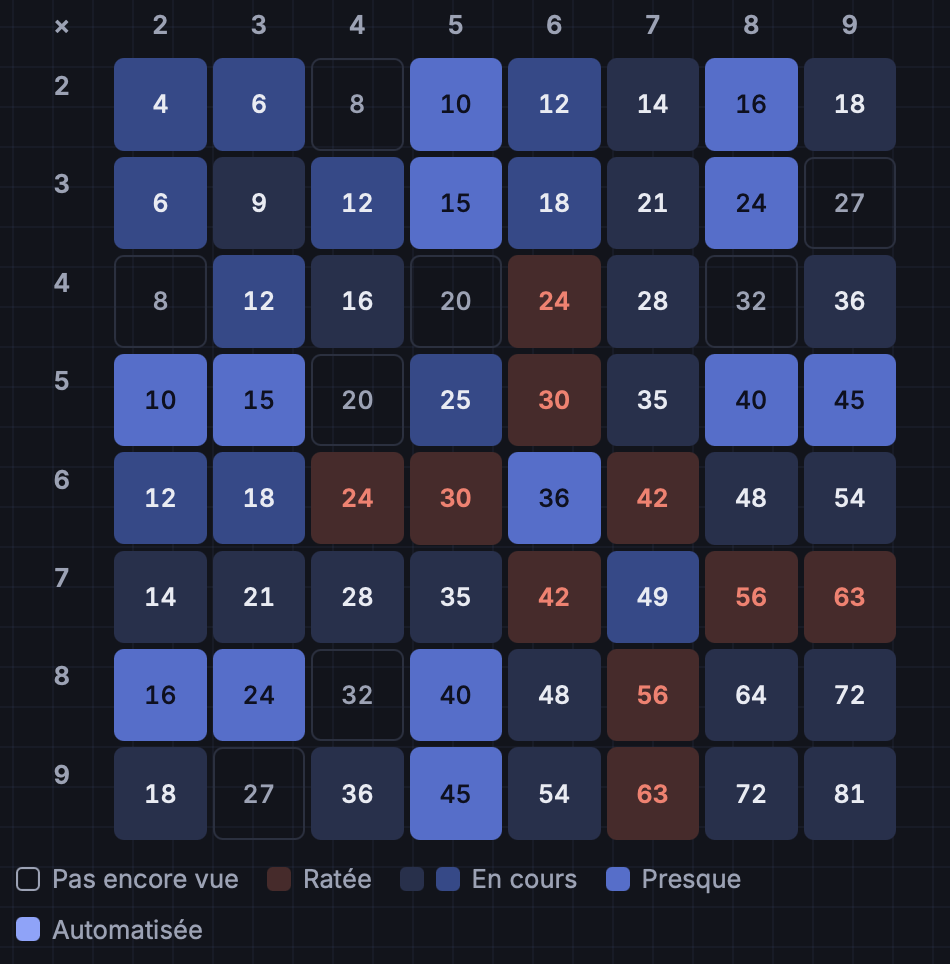

# Journal

Une entrée par jour de travail, la plus récente en haut.

## 2026-11-23

**Nombres relatifs.** Suite du cours de 4e d'Yvan Monka : signe d'un produit sans le calculer. Rappel de ce que j'avais oublié : $0$ est à la fois positif et négatif, donc $0 = -0$.

## 2026-11-21

**Nombres relatifs.** J'ai revu la règle des signes. Notion encore en cours.

**Fractions.** J'ai regardé les vidéos d'Yvan Monka sur les fractions (cours de 4e, qui couvre aussi la 6e, la 5e et la 3e) et refait les exemples. J'ai appris à simplifier une fraction par décomposition en nombres premiers. Je trouve très élégant le théorème fondamental de l'arithmétique, qui la justifie : tout entier supérieur à 1 s'écrit d'une seule façon comme produit de nombres premiers. J'ai aussi revu la division euclidienne posée. J'ai ensuite demandé quelques exercices à une IA.

**Erreur.** Pour simplifier $\frac{110}{132}$, j'ai voulu diviser le numérateur et le dénominateur par 100. En réalité, j'ai soustrait 100 aux deux, et j'ai obtenu $\frac{10}{32}$. Soustraire le même nombre en haut et en bas change la valeur d'une fraction. Seules la multiplication et la division par un même nombre non nul la conservent. Une estimation rapide aurait suffi à repérer l'erreur : $\frac{110}{132}$ vaut un peu moins de 1, alors que $\frac{10}{32}$ vaut environ un tiers. Je l'ai corrigée par décomposition en facteurs premiers : $110 = 2 \times 5 \times 11$ et $132 = 2^2 \times 3 \times 11$, donc $\frac{110}{132} = \frac{5}{6}$ (Fractions, [exercice 1](maths/algebre/02-fractions/exercices.md)).

**Tables de multiplication.** Je constate qu'elles ne sont pas automatisées, et ça me ralentit dans les calculs de fractions. Je m'entraîne chaque jour sur une page qui pose les multiplications des tables de 2 à 9 au hasard et chronomètre mes réponses. Une réponse compte comme automatisée si elle est juste en moins de 3 secondes, trois fois de suite. Mes erreurs portent surtout sur les tables de 6 et de 7.

## 2026-11-20

**Nombres relatifs.** Rappel du cours de 4e d'Yvan Monka : opérations sur les nombres relatifs, puissances d'un nombre négatif, règle des signes d'un produit (nombre de facteurs négatifs pair ou impair).

**Erreurs.** J'écrivais les nombres négatifs sans parenthèses après un signe d'opération ($-3 \times -2$). Je me suis aussi trompé de signe sur $(-3)^3$. Les deux sont corrigés dans le [chapitre Nombres relatifs](maths/algebre/01-nombres-relatifs/exercices.md).
